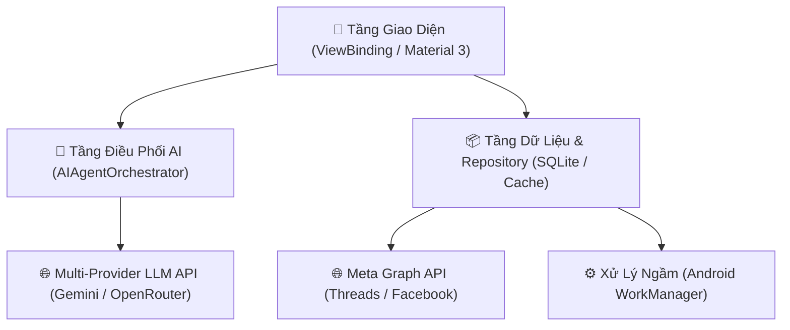

# 📱 TỔNG QUAN DỰ ÁN ĐỒ ÁN CUỐI KỲ: SOCIALAI
**Học phần:** Lập trình thiết bị di động (LTTBDD)  
**Tên đề tài:** Mobile AI Agent Xây Dựng & Quản Lý Kênh Social Media  
**Nhóm sinh viên thực hiện:** Nhóm 04  
**Giảng viên phụ trách:** Thầy Hải Phạm  
**Kho mã nguồn GitHub:** [https://github.com/kikimeomeo/social-ai-agent-nhom4](https://github.com/kikimeomeo/social-ai-agent-nhom4)  

---

## 🎯 1. BÀI TOÁN & MỤC TIÊU DỰ ÁN
Trong thời đại số hóa, việc sáng tạo nội dung và duy trì tương tác trên mạng xã hội đòi hỏi rất nhiều thời gian và nguồn lực.  
**SocialAI** là ứng dụng di động Android Native tích hợp **Hệ thống Multi-Agent AI** thông minh, đóng vai trò như một "phòng Marketing thu nhỏ" hỗ trợ người dùng:
1. **Lập chiến lược & Tự động tạo bài viết:** Nhận chủ đề, giọng văn và đối tượng để tự động viết bài, tạo hình ảnh minh họa phù hợp cho từng kênh.
2. **Kiểm soát nội dung (Human-in-the-loop):** Người dùng toàn quyền xem trước, chỉnh sửa tay hoặc yêu cầu AI viết lại trước khi xuất bản.
3. **Xuất bản đa kênh tự động:** Kết nối trực tiếp API mạng xã hội chính thức (**Meta Threads** & **Facebook Page**), hỗ trợ hàng đợi xuất bản ngoại tuyến khi mất mạng.
4. **Chăm sóc tương tác thông minh:** Tự động thu thập bình luận, dùng AI phân loại cảm xúc và tự động phản hồi có kiểm soát (chặn rủi ro tiêu cực).
5. **Theo dõi tăng trưởng & Quản trị tài nguyên:** Trực quan hóa số liệu tương tác qua biểu đồ và minh bạch chi phí tiêu thụ token AI (BYOK).

---

## 🏗️ 2. KIẾN TRÚC HỆ THỐNG & CÔNG NGHỆ SỬ DỤNG



### Công nghệ cốt lõi:
* **Nền tảng & Ngôn ngữ:** Android Native thuần **Java 17**, `minSdk` API 24 (Android 7.0+), `compileSdk` & `targetSdk` API 37.
* **Kiến trúc phần mềm:** Kiến trúc phân tầng (Layered Architecture):
  * `agent/`: Chứa `AIAgentOrchestrator` và các sub-agent điều phối AI.
  * `data/`: Quản lý SQLite nội bộ (`DatabaseHelper`), điều phối OAuth (`OAuthManager`) và lưu trữ cấu hình/key (`SecurePreferenceManager`).
  * `model/`: Các data class của hệ thống (`Post`, `CommentItem`, `AnalyticsData`, `LLMConfig`, `AgentLog`, `SocialAccount`, `SocialPlatform`).
  * `repository/`: Tầng trung gian cung cấp dữ liệu cho UI (`MockDataRepository`).
  * `ui/`: Các Fragment giao diện 5 Tab chức năng (`home`, `create`, `inbox`, `analytics`, `settings`) và `custom/` (`CustomAnalyticsChartView`).
  * `util/`: Kết nối HTTP (`OkHttp 4`), parse JSON (`Gson`), gọi Meta API (`RealSocialPublisher`), thông báo (`NotificationHelper`) và kiểm tra mạng (`NetworkUtils`).
  * `worker/`: Xử lý tác vụ chạy ngầm và hàng đợi ngoại tuyến (`Android WorkManager`).
* **Trí tuệ nhân tạo (LLM Providers - BYOK):** Hỗ trợ $\ge 2$ nhà cung cấp LLM theo cấu hình BYOK: Google Gemini API (`gemini-3.1-flash-lite` kèm danh sách model dự phòng) và OpenRouter / OpenAI.
* **Kết nối Mạng xã hội:** Meta Graph API chính thức cho 2 kênh mục tiêu:
  * **Threads API v1.0** (Đăng bài container 2 bước, lấy permalink, đọc replies, gửi phản hồi).
  * **Facebook Graph API v19.0** (Facebook Page).

---

## 🌟 3. CHI TIẾT 9 NHÓM CHỨC NĂNG (F1 $\rightarrow$ F9 THEO YÊU CẦU ĐỀ TÀI)

| Nhóm chức năng | Tên tính năng | Mức độ yêu cầu | Phạm vi nghiệp vụ mục tiêu (theo yêu cầu `[B]` trong `ProjectRecord.md`) |
| :--- | :--- | :---: | :--- |
| **F1** | **Tích hợp Mạng xã hội** | `[B] Bắt buộc` | Kết nối tối thiểu 2 kênh (**Meta Threads** & **Facebook Page**) qua OAuth; màn hình "Kênh của tôi" hiển thị trạng thái, tài khoản, chức năng hỗ trợ; tự làm mới/cảnh báo hết hạn token; ngắt kết nối & xoá dữ liệu. |
| **F2** | **AI Agent viết bài & sinh ảnh** | `[B] Bắt buộc` | Kiến trúc Orchestrator - Sub-agents gọi song song theo kênh; luồng *Dàn ý $\rightarrow$ Bản nháp $\rightarrow$ Tự rà quy tắc $\rightarrow$ Mô tả ảnh $\rightarrow$ Sinh ảnh (kèm fallback template) $\rightarrow$ Đóng gói*; stream chữ thời gian thực; huỷ/retry từng kênh; **Agent Logs** (prompt, kết quả, token, chi phí). |
| **F3** | **Nhập topic & brief** | `[B] Bắt buộc` | Nhập văn bản kèm brief: mục tiêu bài viết, đối tượng đọc, giọng văn (Hài hước, Chuyên gia, Thân thiện), ngôn ngữ (VI/EN), chọn kênh đích (**Facebook Page / Threads**). |
| **F4** | **Duyệt & Chỉnh sửa bài** | `[B] Bắt buộc` | **Chốt chặn Human-in-the-loop (cấm tự đăng khi chưa duyệt)**; xem trước Preview theo kênh; sửa tay; đếm giới hạn ký tự (Threads 500 ký tự); AI viết lại từng đoạn (ngắn hơn, trang trọng hơn, đổi hook) & sinh lại ảnh. |
| **F5** | **Đăng mạng xã hội** | `[B] Bắt buộc` | Xuất bản đa kênh đồng thời; quản lý trạng thái từng kênh; hàng đợi ngoại tuyến **Offline Queue** bằng `WorkManager`; chống đăng trùng lặp (idempotency); tự retry lỗi mạng/rate limit & báo rõ lý do lỗi; lưu URL mở bài gốc. |
| **F6** | **Đọc & Trả lời bình luận** | `[B] Bắt buộc` | Hộp thư Inbox hợp nhất có bộ lọc theo kênh, bài viết, trạng thái; kéo làm mới + đồng bộ nền (`CommentSyncWorker`); AI phân loại cảm xúc (Câu hỏi, Khen ngợi, Góp ý, Tiêu cực, Spam); gợi ý trả lời; **tự động trả lời có kiểm soát (chỉ khen ngợi/FAQ, tuyệt đối chặn comment tiêu cực/nhạy cảm)**. |
| **F7** | **Theo dõi tăng trưởng** | `[B] Bắt buộc` | Thống kê số liệu từng bài (like, comment, share, reach, engagement rate); lưu số liệu định kỳ vào SQLite để vẽ **Biểu đồ tăng trưởng** (`CustomAnalyticsChartView`); Dashboard tổng quan (follower theo thời gian, tương tác theo tuần, top bài viết, so sánh giữa các kênh). |
| **F8** | **Quản lý API Key (BYOK)** | `[B] Bắt buộc` | Hỗ trợ $\ge 2$ nhà cung cấp LLM (Gemini, OpenRouter/OpenAI); kiểm tra key hợp lệ khi nhập; lưu an toàn trong thiết bị (không gửi qua server trung gian); che key dạng `••••`; cấu hình model riêng theo tác vụ; giám sát token & chi phí ngày/tháng. |
| **F9** | **Cài đặt chung & Offline** | `[B] Bắt buộc` | Hỗ trợ chuyển đổi đa ngôn ngữ giao diện (**VI / EN**); chế độ **Offline** cho phép xem lại bản nháp, lịch sử bình luận và số liệu thống kê đã lưu trong máy. |

---

## 👥 4. MA TRẬN PHÂN CÔNG THÀNH VIÊN (TEAM MATRIX)

* **Đặng Hoàng Tuấn Kiệt** (`@kikimeomeo` - Nhóm trưởng):
  * Phụ trách: Khung cơ sở ứng dụng (Bootstrap), Core AI Engine (`AIAgentOrchestrator`), luồng nhập Topic & Brief chiến lược (**F2, F3**).
* **Vũ Quốc Huy** (`@huy-vequy`):
  * Phụ trách: Tích hợp Meta Graph API (Facebook Page & Threads), màn hình Kênh của tôi, hàng đợi xuất bản Offline Queue WorkManager (**F1, F5**).
* **Nguyễn Lê Hoàng Thiện** (`@thienshoko`):
  * Phụ trách: Màn hình kiểm duyệt Preview duyệt bài viết, công cụ AI viết lại, Hộp thư Inbox tương tác và Bot phản hồi có kiểm soát (**F4, F6**).
* **Trịnh Văn Hợp** (`@ZanHopUS`):
  * Phụ trách: Quản lý bảo mật API Key BYOK, màn hình Thống kê Analytics & vẽ biểu đồ tăng trưởng, Cài đặt đa ngôn ngữ VI/EN và chế độ SQLite Offline (**F7, F8, F9**).

---

## 📂 5. CẤU TRÚC THƯ MỤC NGUỒN (SOURCE CODE STRUCTURE)
```text
app/src/
├── main/
│   ├── AndroidManifest.xml          # Khai báo quyền mạng, thông báo và Activity
│   ├── java/com/tuankiet/myapplication/
│   │   ├── MainActivity.java        # Điều hướng chính với BottomNavigationView 5 tab
│   │   ├── agent/                   # Hệ thống AI Multi-Agent (Orchestrator, Prompt, Stream)
│   │   ├── data/                    # SQLite DatabaseHelper, OAuthManager & SecurePreferenceManager
│   │   ├── model/                   # Data classes: Post, CommentItem, AnalyticsData, LLMConfig, AgentLog...
│   │   ├── repository/              # MockDataRepository quản lý luồng dữ liệu thống nhất
│   │   ├── ui/                      # 5 Tab Fragment (home, create, inbox, analytics, settings) & custom/
│   │   ├── util/                    # RealSocialPublisher (Meta API), NotificationHelper, NetworkUtils
│   │   └── worker/                  # CommentSyncWorker & PostPublisherWorker (Xử lý ngầm)
│   └── res/                         # Tài nguyên giao diện XML, drawable, themes Material 3
└── test/                            # Unit tests (JUnit)
```

---

## 🚀 6. HƯỚNG DẪN CÀI ĐẶT & CHẠY THỬ NGHIỆM
1. **Clone mã nguồn về máy:**
   ```bash
   git clone https://github.com/kikimeomeo/social-ai-agent-nhom4.git
   ```
2. **Mở dự án:** Khởi động Android Studio $\rightarrow$ Chọn **Open** $\rightarrow$ Trỏ đến thư mục vừa clone.
3. **Cấu hình môi trường:**
   * Đảm bảo đã cài đặt **JDK 17**.
   * Để Gradle tự động đồng bộ dependencies (`compileSdk 37`, `minSdk 24`).
4. **Chạy ứng dụng:**
   * Chọn máy ảo Emulator (**API 24+**) hoặc cắm điện thoại thật (bật USB Debugging).
   * Bấm nút **Run `app`** (`Shift + F10`).
5. **Cấu hình API Key trên App:**
   * Vào tab **Cài đặt (Settings)** $\rightarrow$ Nhập API Key LLM (Google Gemini / OpenRouter) để kích hoạt tính năng AI thật (hoặc bật Chế độ Demo để thử nghiệm).

---

## 📜 7. QUY CHUẨN LÀM VIỆC & ĐÓNG GÓP
* Quy chuẩn Git, Commit, PR, Code Review & Báo cáo tuần: [**CONTRIBUTING.md**](./docs/CONTRIBUTING.md)
* Ma trận phân công chi tiết & vòng xoay Reviewer: [**TEAM_ASSIGNMENT.md**](./docs/TEAM_ASSIGNMENT.md)
* Biên bản họp gốc với Giảng viên: [**ProjectRecord.md**](./ProjectRecord.md)
